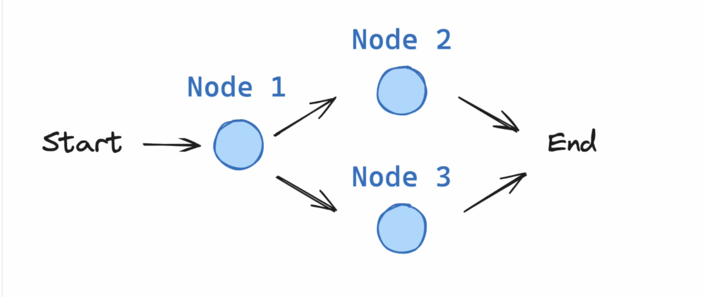
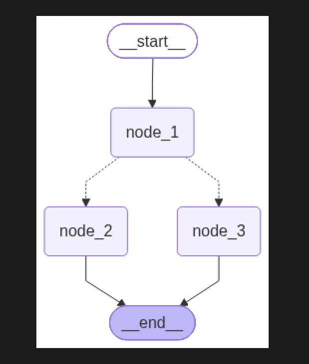

# Resources

- [Lesson 2: Simple Graph video](https://academy.langchain.com/courses/take/intro-to-langgraph/lessons/58238187-lesson-2-simple-graph)
- [Analytics Vidhya blog](https://www.analyticsvidhya.com/blog/2025/05/langgraph-tutorial-for-beginners/)
- Documentation
  - [Nodes](https://docs.langchain.com/oss/python/langgraph/graph-api/#nodes)
  - [Edges](https://docs.langchain.com/oss/python/langgraph/graph-api/#edges)
  - [Conditional Edges](https://docs.langchain.com/oss/python/langgraph/graph-api/#conditional-edges)
  - [Start Node](https://docs.langchain.com/oss/python/langgraph/graph-api/#start-node)
  - [End Node](https://docs.langchain.com/oss/python/langgraph/graph-api/#end-node)
  - [StateGraph Class](https://docs.langchain.com/oss/python/langgraph/graph-api/#stategraph)
  - [Compiling StateGraph](https://docs.langchain.com/oss/python/langgraph/graph-api/#compiling-your-graph)
  - [Runnable](https://reference.langchain.com/python/langchain_core/runnables/?h=runnables)

# Introduction

In this notebook, we will re-created the simple graph defined in [studio/simple.py](module-1/studio/simple.py).



# Core Concepts

## State

A LangGraph **State** is the shared data structure (eg. typed shared memory
object) that represents the current snapshot of the workflow as it moves
through the graph.

```{python}
from typing_extensions import TypedDict


class ExampleState(TypedDict):
    """Data the graph needs to remember and pass between steps."""

    messages: list
    user_intent: str
    result: str


class UserState(TypedDict):
    """State used in current notebook."""

    graph_state: str
```

## Node

**Nodes** are the individual units of work (eg. function). Each node receives
the current state and produces changes to it.

> [!Note] Reducer functions specify how the state should be updated
> By default, the returned value overrides the prior key value. See
> [reducers](https://docs.langchain.com/oss/python/langgraph/graph-api/#reducers)

```{python}
# Print statement only to confirm which node was executed
def node_1(state):
    """Append introduction to initial User state."""
    print("---Node 1---")
    return {"graph_state": state["graph_state"] + " I am"}


def node_2(state):
    """Append happy mood to User state."""
    print("---Node 2---")
    return {"graph_state": state["graph_state"] + " happy!"}


def node_3(state):
    """Append sad mood to User state."""
    print("---Node 3---")
    return {"graph_state": state["graph_state"] + " sad!"}
```

## Edges

**Edges** define how State moves between nodes. _Condictional edges_ determine
the next node based on State. _Normal edges_ connect nodes regardless of state.

```{python}
import random
from typing import Literal


# Conditional edge: return which node to visit next
def decide_mood(state) -> Literal["node_2", "node_3"]:
    """Randomly decide whether mood is `happy` or `sad`."""

    # Often you'd use state here; this toy example does not
    user_input = state["graph_state"]

    # Randomly decide which node to visit next
    if random.random() < 0.5:
        return "node_2"

    return "node_3"
```

## Graph Construction

To create a graph, we must:

- Initialize `StateGraph` object
- Define nodes and edges
- Compile graph

> [!NOTE] Cannot use LangGraph object without compiling

```{python}
from IPython.display import Image, display
from langgraph.graph import END, START, StateGraph

# Initialize LangGraph object
builder = StateGraph(UserState)

# Define nodes in simple graph
builder.add_node("node_1", node_1)
builder.add_node("node_2", node_2)
builder.add_node("node_3", node_3)

# Define edges connecting defined nodes
builder.add_edge(START, "node_1")
builder.add_conditional_edges("node_1", decide_mood)
builder.add_edge("node_2", END)
builder.add_edge("node_3", END)

# Compile Graph
graph = builder.compile()

# View compiled graph as a mermaid chart
display(Image(graph.get_graph().draw_mermaid_png()))
```



## Graph Invocation

To use graph, call `.invoke(<STATE>)` method. By default, graph executed
**synchronously** (nodes executed in sequence).

```{python}
start_state = UserState({"graph_state": "Hi, this is Lance."})
graph.invoke(start_state)
```
