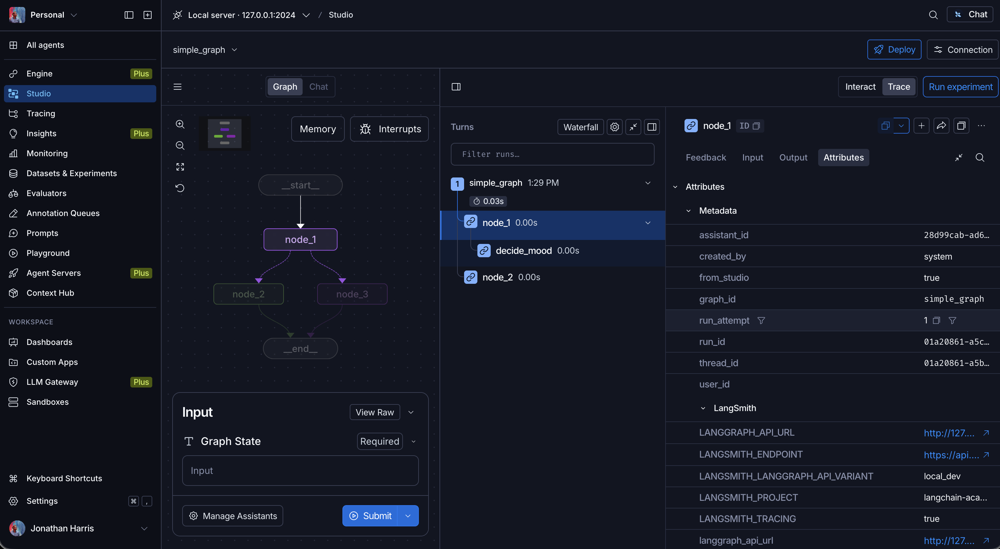

# Confirm LangSmith Studio Working Properly

```{bash}
# Go to directory containing files
cd /Users/jon.harris/code/langchain-academy/module-1/studio/

uv run langgraph dev
```

## Example: simple_graph.py

The file `simple_graph.py` defines and compiles a simple graph. It is available
for use in LangSmith because it is defined in
[langgraph.json](./studio/langgraph.json).



