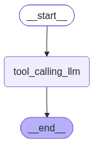
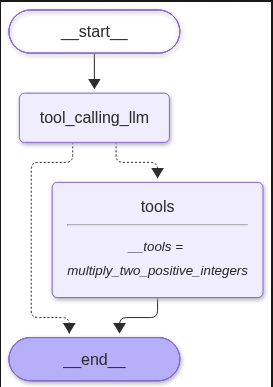

[Lesson #4 video](https://academy.langchain.com/courses/take/intro-to-langgraph/lessons/58238466-lesson-4-chain)

# Langgraph Chains

A **chain** is the simplest structure in LangGraph. It is a fixed, linear
sequence of nodes and _normal_ edges.

Build up to a simple **chain** that combines 4 concepts inside LangGraph:

1. [Chat messages](https://docs.langchain.com/oss/python/langchain/messages) as graph state
2. [Chat models](https://docs.langchain.com/oss/python/integrations/chat) in graph nodes
3. [Binding tools](https://docs.langchain.com/oss/python/langchain/models#tool-calling) to a chat model
4. [Executing tool calls](https://docs.langchain.com/oss/python/langchain/models#tool-execution-loop) in graph nodes

## Messages

Chat models interact with **messages** that are captured in a conversation.
There are four main types of messages:

- [SystemMessage](https://docs.langchain.com/oss/python/langchain/messages#system-message) = instructions that set model behavior
- [HumanMessage](https://reference.langchain.com/python/langchain-core/messages/human/HumanMessage) = Human user input
- [ToolMessage](https://docs.langchain.com/oss/python/langchain/messages#tool-calls) = result of tool call
- [AIMessage](https://docs.langchain.com/oss/python/langchain/messages#ai-message) = model output; may define tools to call and argument inputs

```{python}
from langchain_core.messages import AIMessage

name = "chatbot"  # message role
content = "So you said you were researching ocean mammals?"
AIMessage(content=content, name=name)
```

```{python}
from langchain_core.messages import HumanMessage

name = "human"
content = "Yes, that's right"
HumanMessage(content=content, name=name)
```

## Chat Models

A **chatbot model** is a graph-like object that takes a conversation (eg. list
of messages), calls an LLM, and returns a reply.

```{python}
from langchain.chat_models import init_chat_model
from langchain_core.language_models.chat_models import BaseChatModel

model_provider = "ollama"
model_name = "llama3.1:8b"
llm: BaseChatModel = init_chat_model(model_name, model_provider=model_provider)
```

```{python}
chat_history = [
    AIMessage(content="Are you researching ocean mammals?", name=model_name)
]
chat_history.append(HumanMessage(content="Yes, that's right.", name="Jon"))
chat_history.append(AIMessage(content="What do you want to learn?", name=model_name))
chat_history.append(
    HumanMessage(
        content="Where can I find Orcas in the US?",
        name="Jon",
    )
)

result: AIMessage = llm.invoke(chat_history)
result.pretty_print()
```

## Tools

A **tool** is a function the LLM can request to run (eg. calculations, API
calls, DB lookups). Must _bind_ tools to Model for tool to be available. The
model does not execute the tool, `ToolNode` in the graph does. Output is
organized in a `ToolMessage`.

By default, tool name pulled from function name; tool's description defined by
docstring.

```{python}
from langchain.tools import tool


@tool
def multiply_two_integers(a: int, b: int) -> int:
    """Multiply two integers and return product."""
    return a * b


# Must bind tool to LLM so graph can use it
llm_with_tools = llm.bind_tools([multiply_two_integers])

human_message = HumanMessage(content="What is 2 multiplied by -3?", name="Jon")
out: AIMessage = llm_with_tools.invoke([human_message])
out.pretty_print()
```

Name of tool can be defined separately from function. It is also possible to
define and validate tool input via Pydantic model.

> [!IMPORTANT] Error not raised because tool not executed

```{python}
from pydantic import BaseModel, Field


class MultiplyInput(BaseModel):
    """Input schema for multiplying two integers."""

    a: int = Field(gt=0, description="First number")
    b: int = Field(gt=0, description="Second number")


@tool(args_schema=MultiplyInput)
def multiply_positives(a: int, b: int):
    """Multiply two integers."""
    return a * b


llm_with_tools = llm.bind_tools([multiply_positives])
out: AIMessage = llm_with_tools.invoke([human_message])
out.pretty_print()
```

## Messages as a State

For chatbots, the conversation messages **are** the State. Again, by default,
the state values are overwritten with each LLM call. LangGraph _reducer_
function `add_messages` or `MessagesState` can be used to append new messages
to the State.

```{python}
from langgraph.graph import MessagesState

# class MessagesState(TypedDict):
#      """State messages will be overwritten by each step."""
#
#     messages: list[AnyMessage]
#
#
# class MessageState(TypedDict):
#     """Reducer appends new message with each step."""
#
#     messages: Annotated[list[AnyMessage], add_messages]
#


class MessageState(MessagesState):
    """messages attribute inherited from `MessagesState` class."""
```

# Example Chain Graph

```{python}
from IPython.display import Image, display
from langgraph.graph import END, START, StateGraph

# Must bind tool to LLM
llm_with_tools = llm.bind_tools([multiply_two_integers])


# Must define node that calls LLM with tool
def tool_calling_llm(state: MessagesState) -> dict[str, AIMessage]:
    """Call tool using LLM and return dict with LLM message output."""
    return {"messages": [llm_with_tools.invoke(state["messages"])]}


# Must build and compile graph
builder = StateGraph(MessagesState)
builder.add_node("tool_calling_llm", tool_calling_llm)
builder.add_edge(START, "tool_calling_llm")
builder.add_edge("tool_calling_llm", END)
graph = builder.compile()

# View
display(Image(graph.get_graph().draw_mermaid_png()))
```



```{python}
output = graph.invoke({"messages": HumanMessage(content="Multiply 2 and 3")})
for m in output["messages"]:
    m.pretty_print()
```

## Must add ToolNode to Compute Calculation

> [!IMPORTANT] Tool docstring can influence args passed to ToolNode
> Previously, `multiply_positives` did not return an error because docstring
> explicitly mentioned positive integers. The LLM to pass `3` to the `ToolNode`
> instead of `-3`. **Not sure if due to using small LLM**.

```{python}
from langgraph.prebuilt import ToolNode, tools_condition

# `multiply_positives` should return error if values not positive
tools_lst = [multiply_positives]


def tool_calling_llm(state: MessagesState) -> dict[str, AIMessage]:
    """Call tool using LLM and return dict with LLM message output."""
    return {"messages": [llm.bind_tools(tools_lst).invoke(state["messages"])]}


builder = StateGraph(MessagesState)
builder.add_node("tool_calling_llm", tool_calling_llm)
builder.add_node("tools", ToolNode(tools_lst))
builder.add_edge(START, "tool_calling_llm")
builder.add_conditional_edges("tool_calling_llm", tools_condition)
builder.add_edge("tools", END)
graph = builder.compile()

display(Image(graph.get_graph().draw_mermaid_png()))
```



```{python}
output = graph.invoke({"messages": HumanMessage(content="Multiply 2 and -3")})
for m in output["messages"]:
    m.pretty_print()
```
