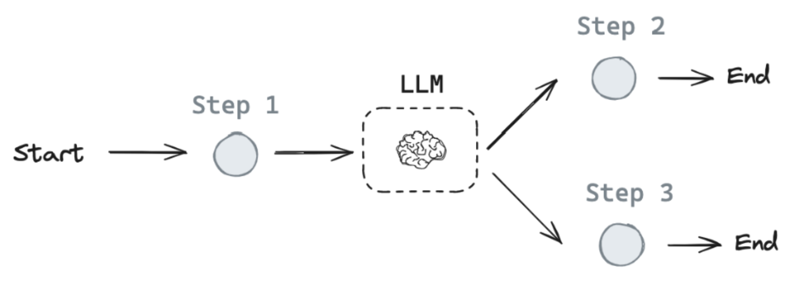
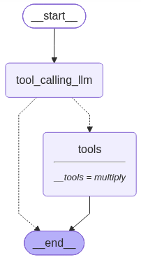

- [Google collab](https://colab.research.google.com/github/langchain-ai/langchain-academy/blob/main/module-1/router.ipynb)
- [Video lesson](https://academy.langchain.com/courses/take/intro-to-langgraph/lessons/58239412-lesson-5-router)

# LangGraph Router

A **router** uses the current State (or other inputs) to determine the next
step.

Typically, a router is decision logic used by a _conditional edge_. This was
the case in [02_simple_graph.qmd](./02_simple_graph.qmd) where the function
`decide_mood` defined logic that was used to determine whether the User was
happy or sad.

It is also possible that a node contains decision logic that drives routing.
For example, an LLM that determine if a tool should be called.



# Example Router

## Initialize Chat Model

```{python}
from langchain.chat_models import init_chat_model
from langchain_core.language_models.chat_models import BaseChatModel

model_provider = "ollama"
model_name = "llama3.1:8b"
llm: BaseChatModel = init_chat_model(model_name, model_provider=model_provider)
```

## Define Tools

```{python}
def multiply(a: int, b: int) -> int:
    """Multiply a and b.

    Args:
        a: first int
        b: second int
    """
    return a * b


llm_with_tools = llm.bind_tools([multiply])
```

## Create Graph

To include `multiply` in our graph, we need to define the following:

1. Node to determine whether `multiply` should be called
2. `ToolNode` to execute `multiply` (if necessary)
3. Logic to route to `ToolNode` or `END` if no tool call is performed

`tool_condition` is a prebuilt routing function for a conditional edge. It
checks the latest message in the graph's State:

- If message contains tool calls -> route to `ToolNode`
- If message doesn't -> route to `END`

```{python}
from IPython.display import Image, display
from langgraph.graph import END, START, MessagesState, StateGraph
from langgraph.prebuilt import ToolNode, tools_condition


# Node
def tool_calling_llm(state: MessagesState):
    return {"messages": [llm_with_tools.invoke(state["messages"])]}


# Build graph
builder = StateGraph(MessagesState)
builder.add_node("tool_calling_llm", tool_calling_llm)
builder.add_node("tools", ToolNode([multiply]))
builder.add_edge(START, "tool_calling_llm")
builder.add_conditional_edges(
    "tool_calling_llm",
    # If the latest message (result) from assistant is a tool call -> tools_condition routes to tools
    # If the latest message (result) from assistant is a not a tool call -> tools_condition routes to END
    tools_condition,
)
builder.add_edge("tools", END)
graph = builder.compile()

# View
display(Image(graph.get_graph().draw_mermaid_png()))
```



## Run Graph

Given the human message, we see that graph runs the tool and appends a
`ToolMessage`.

```{python}
from langchain_core.messages import HumanMessage

messages = [HumanMessage(content="Hello, what is 2 multiplied by 2?")]
messages = graph.invoke({"messages": messages})
for m in messages["messages"]:
    m.pretty_print()
```

However, if the `multiply` tool is not relevant given the human message, then
the routing logic LLM does not respond with a `ToolMessage`.

```{python}

messages = [HumanMessage(content="Is a watermelon a fruit?")]
messages = graph.invoke({"messages": messages})
for m in messages["messages"]:
    m.pretty_print()
```
