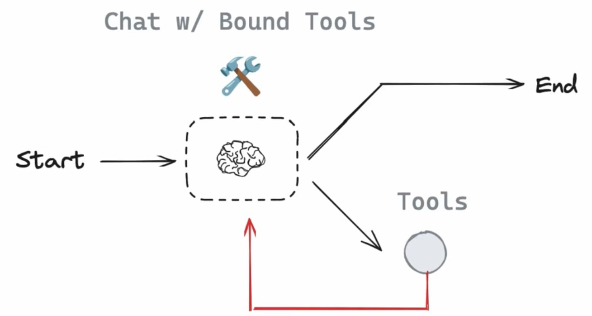
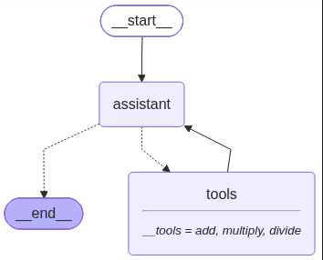
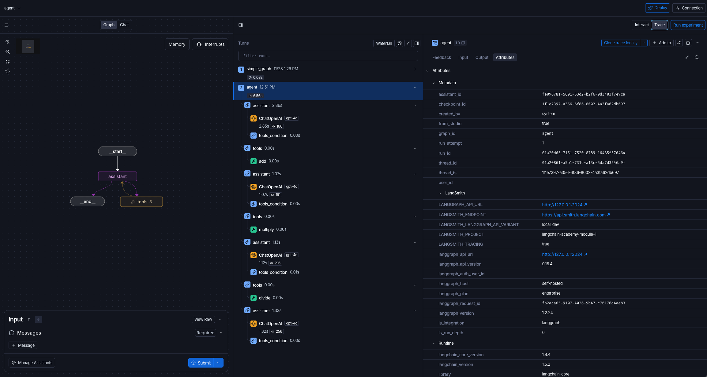

- [Google collab](https://colab.research.google.com/github/langchain-ai/langchain-academy/blob/main/module-1/agent.ipynb)
- [Video lesson](https://academy.langchain.com/courses/take/intro-to-langgraph/lessons/58239412-lesson-5-router)

# LangGraph Agent

An **Agent** is a graph-based system that uses a model to decide which actions
to take, such as calling tools, and _use their results to continue towards that
goal_.

A router, like the one created in [05_router.qmd](./05_router.qmd), is a
_single-step tool-calling agent_. The LLM decided whether to call a tool or
respond directly, but if a tool runs, the graph ends without feeding its result
back to the LLM. It therefore doesn’t have the iterative reasoning-and-action
loop often associated with agents.

However, we can extend the router into a generic agent architecture. Instead of
passing the `ToolMessage` to the user, we can pass the message back to the LLM.


This is the intuition behind [ReAct](https://react-lm.github.io/), a general agent architecture.

- **Act** -- let model call specific tools
- **Observe** -- pass tool output back to model
- **Reason** -- let model reason about tool output to decide what to do next
  - Call another tool or just respond to user directly

# Example ReAct Agent Architecture

## Initialize Chat Model

```{python}
from langchain.chat_models import init_chat_model
from langchain_core.language_models.chat_models import BaseChatModel

model_provider = "ollama"
model_name = "llama3.1:8b"
llm: BaseChatModel = init_chat_model(model_name, model_provider=model_provider)
```

## Define Tools

> [!WARNING] Math tools should be executed sequentially
> OpenAI models specifically defaults to parallel tool calling for efficiency.
> This can be disabled by `parallel_tool_calls=False` input. Not all models,
> like Ollama, take this input argument.

```{python}
def multiply(a: int, b: int) -> int:
    """Multiply a and b.

    Args:
        a: first int
        b: second int
    """
    return a * b


# This will be a tool
def add(a: int, b: int) -> int:
    """Adds a and b.

    Args:
        a: first int
        b: second int
    """
    return a + b


def divide(a: int, b: int) -> float:
    """Divide a and b.

    Args:
        a: first int
        b: second int
    """
    return a / b


tools = [add, multiply, divide]
llm_with_tools = llm.bind_tools(tools)
```

## Create Graph

```{python}
from langchain_core.messages import SystemMessage
from langgraph.graph import MessagesState

# System message
sys_msg = SystemMessage(
    content="You are a helpful assistant tasked with performing arithmetic on a set of inputs."
)


# Node
def assistant(state: MessagesState):
    return {"messages": [llm_with_tools.invoke([sys_msg] + state["messages"])]}
```

Previously, our _single-step tool-calling agent_ routed the output of the
`ToolNode` to `END` (eg. `builder.add_edge("tools", END)`). To implement the
ReAct agent architecture, we instead route output of `ToolNode` back to our
`Assistant` node. Only `tools_condition` routing logic determines whether
output routes to `END`.

```{python}
from IPython.display import Image, display
from langgraph.graph import START, StateGraph
from langgraph.prebuilt import ToolNode, tools_condition

# Graph
builder = StateGraph(MessagesState)

# Define nodes: these do the work
builder.add_node("assistant", assistant)
builder.add_node("tools", ToolNode(tools))

# Define edges: these determine how the control flow moves
builder.add_edge(START, "assistant")
builder.add_conditional_edges(
    "assistant",
    tools_condition,
)
builder.add_edge("tools", "assistant")
react_graph = builder.compile()

# Show
display(Image(react_graph.get_graph(xray=True).draw_mermaid_png()))
```



## Run Graph

Given the human message, we see that graph runs the tool and appends a
`ToolMessage`.

```{python}
from langchain_core.messages import HumanMessage

content = "Add 3 and 4. Multiply the output by 2. Divide the output by 5"
messages = [HumanMessage(content=content)]
messages = react_graph.invoke({"messages": messages})
for m in messages["messages"]:
    m.pretty_print()
```

If we manually enter the same message into LangSmith, we can trace the entire
process.


