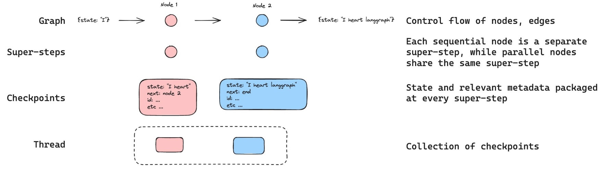

- [Google collab](https://colab.research.google.com/github/langchain-ai/langchain-academy/blob/main/module-1/agent-memory.ipynb))
- [Video lesson](https://academy.langchain.com/courses/take/intro-to-langgraph/lessons/58239417-lesson-7-agent-with-memory)

# Agent Memory

Calling `graph.invoke(...)` executes a compiled LangGraph from `START` to `END`
where each node updates `MessagesState`. By default, the State is transient to
a single graph execution. Executing the graph again does not build on the
previous conversation.

A **checkpoint** in LangGraph is a saved snapshot of the graph's State at a
particular point during execution. Checkpoints are typically associated with a
**thread**, so different conversations/workflow instances can maintain separate
histories.

A common checkpointer is `MemorySaver` which store a collection of States in a
single `thread_id`.



# MemorySaver Example

## ReAct Agent Architecture Example

```{python}
from langchain.chat_models import init_chat_model
from langchain_core.language_models.chat_models import BaseChatModel

model_provider = "ollama"
model_name = "llama3.1:8b"
llm: BaseChatModel = init_chat_model(model_name, model_provider=model_provider)
```

```{python}
def multiply(a: int, b: int) -> int:
    """Multiply a and b.

    Args:
        a: first int
        b: second int
    """
    return a * b


# This will be a tool
def add(a: int, b: int) -> int:
    """Adds a and b.

    Args:
        a: first int
        b: second int
    """
    return a + b


def divide(a: int, b: int) -> float:
    """Divide a and b.

    Args:
        a: first int
        b: second int
    """
    return a / b


tools = [add, multiply, divide]
llm_with_tools = llm.bind_tools(tools)
```

```{python}
from langchain_core.messages import SystemMessage
from langgraph.graph import MessagesState

# System message
sys_msg = SystemMessage(
    content="You are a helpful assistant tasked with performing arithmetic on a set of inputs."
)


# Node
def assistant(state: MessagesState):
    return {"messages": [llm_with_tools.invoke([sys_msg] + state["messages"])]}
```

```{python}
from langgraph.graph import START, StateGraph
from langgraph.prebuilt import ToolNode, tools_condition

# Graph
builder = StateGraph(MessagesState)

# Define nodes: these do the work
builder.add_node("assistant", assistant)
builder.add_node("tools", ToolNode(tools))

# Define edges: these determine how the control flow moves
builder.add_edge(START, "assistant")
builder.add_conditional_edges(
    "assistant",
    # If the latest message (result) from assistant is a tool call -> tools_condition routes to tools
    # If the latest message (result) from assistant is a not a tool call -> tools_condition routes to END
    tools_condition,
)
builder.add_edge("tools", "assistant")
react_graph = builder.compile()
```

## Define Graph with Memory

```{python}
from langgraph.checkpoint.memory import MemorySaver

memory = MemorySaver()
react_graph_memory = builder.compile(checkpointer=memory)
```

## Run Graph

```{python}
# Specify a thread
config = {"configurable": {"thread_id": "1"}}

# Specify an input
messages = [HumanMessage(content="Add 3 and 4.")]

# Run
messages = react_graph_memory.invoke({"messages": messages}, config)
for m in messages["messages"]:
    m.pretty_print()
```

By passing the same thread (eg. `config`) to `graph.invoke` it is possible to
pick up from the last graph execution.

```{python}
messages = [HumanMessage(content="Multiply that by 2.")]
messages = react_graph_memory.invoke({"messages": messages}, config)
```
