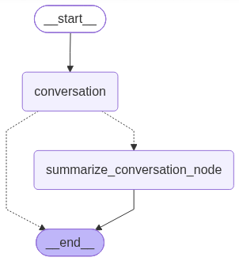

- [Google collab](https://colab.research.google.com/github/langchain-ai/langchain-academy/blob/main/module-2/chatbot-summarization.ipynb)
- [Video lesson](https://academy.langchain.com/courses/take/intro-to-langgraph/lessons/58239436-lesson-5-chatbot-w-summarizing-messages-and-memory)

# Chatbot with Message Summarization

Long-conversations increase token usage and latency as the State grows.
Previously, `RemoveMessage` was used to drop older messages. However, this may
remove relevant context the LLM needs. To avoid this, it is possible to
summarize the previous messages.

```{python}
from langchain.chat_models import init_chat_model
from langchain_core.language_models.chat_models import BaseChatModel

model_provider = "ollama"
model_name = "llama3.1:8b"
llm: BaseChatModel = init_chat_model(model_name, model_provider=model_provider)
```

## Example of Summarization

```{python}
from typing import Literal

from langchain_core.messages import HumanMessage, RemoveMessage, SystemMessage
from langgraph.graph import END, MessagesState


class SummaryState(MessagesState):
    summary: str


def summarize_conversation_node(state: SummaryState) -> SummaryState:
    """Summarize messages, if possible, and drop previous messages."""
    summary = state.get("summary", "")
    if summary:
        summary_message = (
            f"Summary of converation to date: {summary}\n\n"
            "Extend the summary by taking into account the new messages above:"
        )
    else:
        summary_message = "Create a summary of the conversation above:"

    # Generate summary of previous conversation
    messages = state["messages"] + [HumanMessage(content=summary_message)]
    response = llm.invoke(messages)

    # Delete all but the two most recent messages (arbitrary)
    delete_messages = [RemoveMessage(id=m.id) for m in state["messages"][:-2]]
    return {"summary": response.content, "messages": delete_messages}


def call_model_node(state: SummaryState) -> SummaryState:
    """Invoke LLM with summary (optional) and latest messages."""
    summary = state.get("summary", "")
    if summary:
        system_message = f"Summary of previous conversation: {summary}"
        messages = [SystemMessage(content=system_message)] + state["messages"]
    else:
        messages = state["messages"]
    return {"messages": llm.invoke(messages)}


def should_continue_edge(
    state: SummaryState,
) -> Literal["summarize_conversation_node", END]:
    """Summarize conversations >3 messages."""
    messages = state["messages"]
    if len(messages) > 3:
        return "summarize_conversation_node"
    return END


from IPython.display import Image, display
from langgraph.graph import START, StateGraph

# Define a new graph
workflow = StateGraph(SummaryState)
workflow.add_node("conversation", call_model_node)
workflow.add_node(summarize_conversation_node)

# Set the entrypoint as conversation
workflow.add_edge(START, "conversation")
workflow.add_conditional_edges("conversation", should_continue_edge)
workflow.add_edge("summarize_conversation_node", END)

memory = MemorySaver()
graph = workflow.compile(checkpointer=memory)
display(Image(graph.get_graph().draw_mermaid_png()))
```



In this example, `messages` at `START` contains four messages. Since there is
no summary, `call_model_node` returns the original messages + LLM response.
Since `len(messages)>3`, `should_continue_edge` sends the State to
`summarize_convesration_node`. Since there is no summary, the LLM is instructed
to create a summary. Next, `RemoveMessage` reducer is used to drop all but the
last two messages -> "I like trucks" + LLM response from `call_model_node`.

```{python}
input_messages = [
    HumanMessage("Hi, my name is Jon.", name="jon"),
    HumanMessage("I like turtles.", name="jon"),
    HumanMessage("I like ice cream.", name="jon"),
    HumanMessage("I like trucks.", name="jon"),
]
config = {"configurable": {"thread_id": "1"}}
output = graph.invoke({"messages": input_messages}, config=config)
for m in output["messages"]:
    m.pretty_print()
```

```{python}
graph.get_state(config).values.get("summary", "")
```
