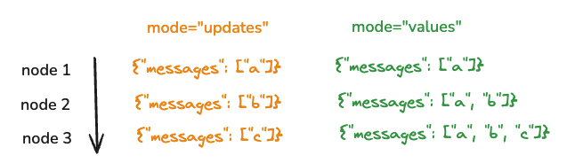

- [Google collab](https://colab.research.google.com/github/langchain-ai/langchain-academy/blob/main/module-3/streaming-interruption.ipynb)
- [Video lesson](https://academy.langchain.com/courses/take/intro-to-langgraph/lessons/58239464-lesson-1-streaming)

# Streaming

`graph.invoke` executes the graph and returns an output once the entire graph
has finished. Alternatively, it is possible to _stream_ the graph's progresses
as it executes.

# Preliminaries

```{python}

from typing import Literal

from IPython.display import Image, display
from langchain.chat_models import init_chat_model
from langchain_core.language_models.chat_models import BaseChatModel
from langchain_core.messages import HumanMessage, RemoveMessage, SystemMessage
from langgraph.checkpoint.memory import MemorySaver
from langgraph.graph import END, START, MessagesState, StateGraph


class SummaryState(MessagesState):
    summary: str


model_provider = "ollama"
model_name = "llama3.1:8b"
llm: BaseChatModel = init_chat_model(model_name, model_provider=model_provider)


def summarize_conversation_node(state: SummaryState) -> SummaryState:
    """Summarize messages, if possible, and drop previous messages."""
    summary = state.get("summary", "")
    if summary:
        summary_message = (
            f"Summary of converation to date: {summary}\n\n"
            "Extend the summary by taking into account the new messages above:"
        )
    else:
        summary_message = "Create a summary of the conversation above:"

    # Generate summary of previous conversation
    messages = state["messages"] + [HumanMessage(content=summary_message)]
    response = llm.invoke(messages)

    # Delete all but the two most recent messages (arbitrary)
    delete_messages = [RemoveMessage(id=m.id) for m in state["messages"][:-2]]
    return {"summary": response.content, "messages": delete_messages}


def call_model_node(state: SummaryState) -> SummaryState:
    """Invoke LLM with summary (optional) and latest messages."""
    summary = state.get("summary", "")
    if summary:
        system_message = f"Summary of previous conversation: {summary}"
        messages = [SystemMessage(content=system_message)] + state["messages"]
    else:
        messages = state["messages"]
    return {"messages": llm.invoke(messages)}


def should_continue_edge(
    state: SummaryState,
) -> Literal["summarize_conversation_node", END]:
    """Summarize conversations >3 messages."""
    messages = state["messages"]
    if len(messages) > 3:
        return "summarize_conversation_node"
    return END


# Define a new graph
workflow = StateGraph(SummaryState)
workflow.add_node("conversation", call_model_node)
workflow.add_node(summarize_conversation_node)

# Set the entrypoint as conversation
workflow.add_edge(START, "conversation")
workflow.add_conditional_edges("conversation", should_continue_edge)
workflow.add_edge("summarize_conversation_node", END)

memory = MemorySaver()
graph = workflow.compile(checkpointer=memory)
display(Image(graph.get_graph().draw_mermaid_png()))
```

# Streaming Full State

- `graph.stream`: synchronous; node A -> node B -> node C
- `graph.astream`: asynchronous; node execution is not linear

LangGraph supports several different streaming modes, that control what is
streamed to the User.

- `stream_mode="values"`: full state of graph after each node is called
- `stream_mode="updates"`: updates to state of graph after each node is called



## Stream Updates

Only stream updates to the graph. In this example, the new AI message is
returned.

```{python}
config = {"configurable": {"thread_id": "1"}}
for chunk in graph.stream(
    {"messages": [HumanMessage(content="hi! I'm Lance")]}, config, stream_mode="updates"
):
    chunk["conversation"]["messages"].pretty_print()
```

## Stream Values

Stream full state at each node. In this example, the original human message,
and human message + AI message, are streamed.

```{python}
config = {"configurable": {"thread_id": "2"}}
input_message = HumanMessage(content="hi! I'm Lance")
for event in graph.stream({"messages": [input_message]}, config, stream_mode="values"):
    for m in event["messages"]:
        m.pretty_print()
    print("---" * 25)
```

# Streaming Tokens

With chat-models, it is common to stream the tokens as they are generated. This
is possible with the `.astream_events` method, which streams back events as
they happen inside the node. An event is a `dict` defined by a few keys:

- `event`: type of event being emitted
- `name`: name of event
- `data`: data associated with event
- `metadata`: contains `langgraph_ndoe`, the node emitting the event

The central point is that tokens from chat models within your graph have the
`on_chat_model_stram` type.

```{python}
node_to_stream = "conversation"
config = {"configurable": {"thread_id": "4"}}
input_message = HumanMessage(content="Tell me about the 49ers NFL team")
async for event in graph.astream_events(
    {"messages": [input_message]}, config, version="v2"
):
    # Get chat model tokens from a particular node
    if (
        event["event"] == "on_chat_model_stream"
        and event["metadata"].get("langgraph_node", "") == node_to_stream
    ):
        print(event["data"])
```
