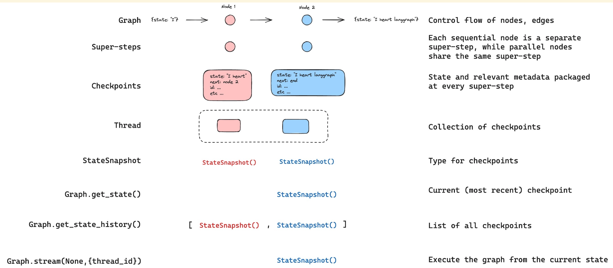

- [Google collab](https://colab.research.google.com/github/langchain-ai/langchain-academy/blob/main/module-3/breakpoints.ipynb)
- [Video lesson](https://academy.langchain.com/courses/take/intro-to-langgraph/lessons/58239469-lesson-2-breakpoints)

# Breakpoints

A _breakpoint_* pauses graph execution before (or after) a named node.
Execution stops in an interrupted state; with a _checkpointer_ and `thread_id`,
allowing humans to inspect the state and resume from the same checkpoint.
Breakpoints turn the graph into a _controllable process_:

1. `approval`: interrupt agent -> surface state -> allow user to approve
2. `debugging`: rewind graph to reproduce or avoid issues
3. `editing`: modify the state

```{python}
from langchain.chat_models import init_chat_model
from langchain_core.language_models.chat_models import BaseChatModel

model_provider = "ollama"
model_name = "llama3.1:8b"
llm: BaseChatModel = init_chat_model(model_name, model_provider=model_provider)
```

# Example: Human Approval

Here, we re-create a simple agent from Module 1. To add a breakpoint for human
approval we compile the graph with `interrupt_before=["tools"]`, where `tools`
is the name of our `ToolNode`.

## Create Graph with Breakpoint

```{python}
from IPython.display import Image, display
from langchain_core.messages import SystemMessage
from langgraph.checkpoint.memory import MemorySaver
from langgraph.graph import START, MessagesState, StateGraph
from langgraph.prebuilt import ToolNode, tools_condition


def multiply(a: int, b: int) -> int:
    """Multiply a and b.

    Args:
        a: first int
        b: second int
    """
    return a * b


# This will be a tool
def add(a: int, b: int) -> int:
    """Adds a and b.

    Args:
        a: first int
        b: second int
    """
    return a + b


def divide(a: int, b: int) -> float:
    """Divide a by b.

    Args:
        a: first int
        b: second int
    """
    return a / b


tools = [add, multiply, divide]
llm_with_tools = llm.bind_tools(tools)


# System message
sys_msg = SystemMessage(
    content="You are a helpful assistant tasked with performing arithmetic on a set of inputs."
)


# Node
def assistant(state: MessagesState):
    return {"messages": [llm_with_tools.invoke([sys_msg] + state["messages"])]}


# Graph
builder = StateGraph(MessagesState)

# Define nodes: these do the work
builder.add_node("assistant", assistant)
builder.add_node("tools", ToolNode(tools))

# Define edges: these determine the control flow
builder.add_edge(START, "assistant")
builder.add_conditional_edges(
    "assistant",
    # If the latest message (result) from assistant is a tool call -> tools_condition routes to tools
    # If the latest message (result) from assistant is a not a tool call -> tools_condition routes to END
    tools_condition,
)
builder.add_edge("tools", "assistant")

memory = MemorySaver()
graph = builder.compile(interrupt_before=["tools"], checkpointer=memory)

# Show
display(Image(graph.get_graph(xray=True).draw_mermaid_png()))
```

## Confirm Tool Did Not Execute

Below we see that the tool did not execute, and is waiting for human input.

```{python}
from langchain_core.messages import HumanMessage

initial_input = {"messages": HumanMessage(content="Multiply 2 and 3")}
thread = {"configurable": {"thread_id": "1"}}

for event in graph.stream(initial_input, thread, stream_mode="values"):
    event["messages"][-1].pretty_print()
```

Here, we can get the state and confirm that the next node to call is `tools`.

```{python}
state = graph.get_state(thread)
state.next
```


If we invoke the graph with `None`, the graph will continue from the last state
checkpoint. For clarity, LangGraph will re-emit the current state (in this case
the `AIMessage` with the tool call).

```{python}
for event in graph.stream(None, thread, stream_mode="values"):
    event["messages"][-1].pretty_print()
```

## Add User Approval Step

```{python}
# Input
initial_input = {"messages": HumanMessage(content="Multiply 2 and 3")}

# Thread
thread = {"configurable": {"thread_id": "2"}}

# Run the graph until the first interruption
for event in graph.stream(initial_input, thread, stream_mode="values"):
    event["messages"][-1].pretty_print()

# Get user feedback
user_approval = input("Do you want to call the tool? (yes/no): ")

# Check approval
if user_approval.lower() == "yes":
    # If approved, continue the graph execution
    for event in graph.stream(None, thread, stream_mode="values"):
        event["messages"][-1].pretty_print()

else:
    print("Operation cancelled by user.")
```
